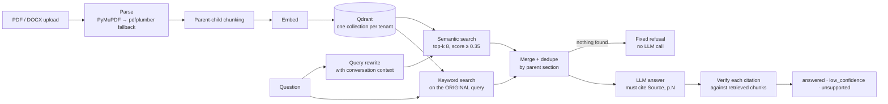

# PolicyLens

**Ask your organization's policies a question in plain language. Get a short answer with page-level citations you can check.**

PolicyLens is a multi-tenant retrieval-augmented generation (RAG) assistant for policy
and compliance documents. An organization uploads its PDFs and DOCX files. Staff ask
questions like *"how much notice do I need to give before using PTO?"* and get an answer
grounded in the documents, with every claim tied to a document and page. When the
documents don't answer the question, it says so instead of guessing.

**Status: working prototype.** The full pipeline runs end to end, from upload through
ingestion, retrieval and a cited answer, with an admin UI and offline deployment. It was
submitted to a municipal innovation program in August 2026. It has no customers or
production deployment yet. *The source is private; this repo is the case study, with
excerpts published from the real code.*

---

## Architecture

**Backend:** Python, FastAPI, Postgres (Alembic, 5 migrations), Qdrant ·
**Frontend:** React, Vite, Tailwind ·
**Deploy:** Docker Compose (5 compose files, including an offline bundle) ·
**No LangChain or LlamaIndex.** The pipeline is plain code, so I can read every step of it.

## Design decisions

**Hybrid search, because embeddings blur acronyms.** Policy documents are full of short
acronyms and codes, and nearest-neighbor search treats them as noise. Keyword search runs on
the user's *original* query, not the rewritten one, and its hits are merged in just above
the semantic threshold. → [`excerpts/pipeline_answer.py`](excerpts/pipeline_answer.py)

**Citations are checked, not trusted.** The model has to cite `[Source: doc, p.N]`. Each
marker is matched against the chunks that were actually retrieved. A citation that points
anywhere else is still shown, but labeled `unverified`. → [`excerpts/citations.py`](excerpts/citations.py)

**Small chunks to find, whole sections to answer.** Child chunks keep retrieval precise.
Each one carries its parent section (±4 neighbors, capped at 6,000 characters), and that
section is what the LLM sees, so conditional logic like *"unless…"* or *"except when…"*
isn't cut off. Sections are deduplicated so the same one isn't sent twice.

**Refuse without calling the model.** If retrieval finds nothing, PolicyLens returns a
fixed answer and never calls the LLM, so there's nothing to hallucinate from. Answers are
also labeled: `unsupported` when context was found but nothing could be cited, and
`low_confidence` when the mean retrieval score is below 0.50.

**Every provider behind an interface.** The LLM (OpenAI, Anthropic or Ollama), the
embedding model and storage (local, S3 or Azure) are chosen in one factory file. An offline
install switches to Ollama by changing configuration, not code.
→ [`excerpts/adapters_base.py`](excerpts/adapters_base.py), [`excerpts/adapters_factory.py`](excerpts/adapters_factory.py)

**Tenancy enforced on the server.** The tenant always comes from the verified JWT, never from
the request. Each request checks the token against a blocklist and confirms the user is
active and belongs to the tenant, using the live role from the database. Every tenant has its
own vector collection, and every Postgres query filters on tenant.

**Ingestion that survives concurrency and re-uploads.** When parallel uploads race to create
the same collection, the conflict error is treated as success. Re-indexing a new document
version deletes the old version's vectors, so outdated policy text can't be retrieved.

## What I'd do next

I'd rather be clear about the gaps than oversell it:

- **An evaluation harness is the biggest missing piece.** There's no retrieval-quality or
  answer-accuracy number yet. A labeled question set with recall@k and citation precision
  would come next, before any other tuning.
- **Defense in depth on tenancy.** Isolation is enforced in the application layer and through
  per-tenant collections. Postgres row-level security and a `tenant_id` payload filter on
  semantic search would add a second wall.
- **Narrower error handling** in the retrieval path, which currently treats any search error
  as "collection not created yet".
- SSO, Terraform, and accessibility testing are not built.

## By the numbers

| | |
|---|---|
| Backend | ~6.1k lines of Python, 35 endpoints |
| Frontend | ~9.2k lines of TypeScript/React |
| Tests | 71 test functions. The 31-test unit suite (auth, chunking, citations) passes in 1.8 s |
| History | 46 commits, March–September 2026 |

---

*Built by [Aniken Nielson](https://github.com/havenlabs-dev) under HavenLabs.*
